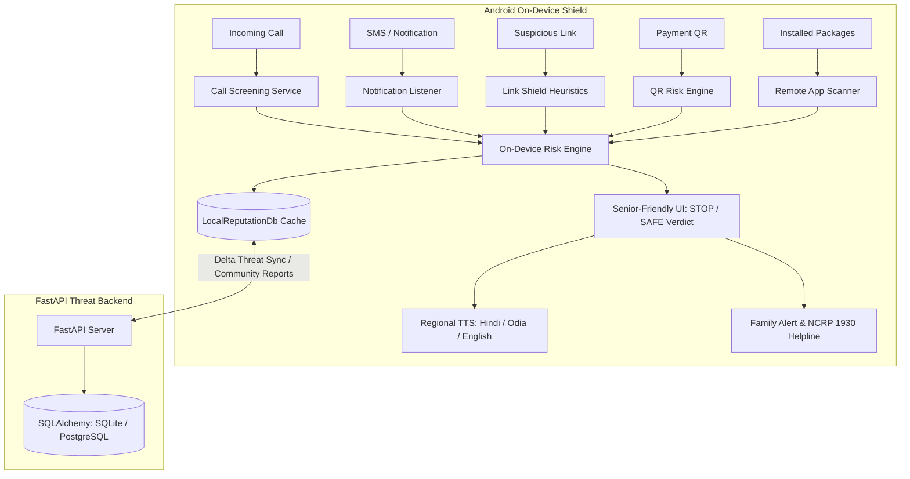

# 🛡️ Suraksha Saathi (सुरक्षा साथी)
### Senior-First Cyber Safety Shield & Family Guardian Network

[](https://kotlinlang.org/)
[](https://developer.android.com/jetpack/compose)
[](https://fastapi.tiangolo.com/)
[](https://www.python.org/)
[](README.md)

---

## 🌟 Overview
**Suraksha Saathi** is an intelligent, senior-centric cyber protection application engineered to safeguard elderly citizens and vulnerable users from digital arrest scams, fake bank calls, look-alike phishing domains, extortion messages, and fraudulent remote-access software.

Designed specifically for non-technical seniors, the system replaces cryptic security warnings with high-contrast, zero-jargon visual cues (**STOP / SAFE**), **multilingual spoken voice guidance** (English, Hindi, and Odia), a trusted family guardian alert loop, and a privacy-preserving cloud threat intelligence synchronization backend.

---

## 🔒 Core Privacy Guarantee
> **Zero Private Message Transmission**  
> Private SMS, screen feeds, and family conversations **never leave the user's device**. All heuristic regex analysis, intent classification, and screening decisions execute entirely on-device. The FastAPI cloud backend is solely queried for anonymized phone/domain reputation lookups and community delta threat intelligence.

---

## ✨ Features & Multi-Modal Shields

### 1. 📞 Call Shield (`SurakshaCallScreeningService`)
- Integrates with Android Telecom `CallScreeningService` to intercept incoming calls.
- Instantly matches callers against on-device scam databases (`LocalReputationDb.kt`).
- Automatically silences reported scammers (fake bank agents, extortionists, police impersonators) and triggers a spoken heads-up warning.

### 2. 💬 Message Shield (`ScamNotificationService`)
- On-device `NotificationListenerService` inspecting incoming SMS and messaging notifications.
- Flags urgent language patterns (*"account blocked in 2 hours"*, *"electricity disconnection tonight"*), OTP-harvesting triggers, and unverified shortlinks.

### 3. 🔗 Link Shield (`LinkShieldScreen`)
- Analyzes URLs without requiring the senior to open the malicious web page.
- Detects look-alike domain permutations (e.g., `sbi-login-verification.xyz`) using heuristic scoring and community blacklists.

### 4. 📱 App & Screen Shield (`RemoteAppScanner`)
- Scans device packages for remote access tools frequently misused in financial fraud (AnyDesk, TeamViewer, RustDesk, AirDroid).
- Alerts the senior immediately if an unauthorized remote session application is detected.

### 5. 💳 QR Shield (`QrRiskEngine`)
- Analyzes payment QR codes and flags reverse-UPI fraud (*"Scan this QR code and enter UPI PIN to receive money"*).

### 6. 🗣️ Multilingual Regional Voice Guidance
- Native voice guidance and audio alerts in **Hindi (हिन्दी)**, **Odia (ଓଡ଼ିଆ)**, and **English**.
- Floating **"क्या यह सुरक्षित है? / Is This Safe?"** assistant that provides spoken verdicts for common fraud scenarios.

### 7. 👨‍👩‍👧 Family Guardian Network & Golden Hour Emergency (1930)
- **Ask Family**: Sends pre-formatted alert SMS to trusted emergency contacts when a scam is detected.
- **Golden Hour SOS**: 1-tap direct dialer to the **National Cyber Crime Reporting Helpline (1930)** with step-by-step account freeze instructions.

### 8. ☁️ Cloud Threat Engine (FastAPI + PostgreSQL / SQLite)
- Standalone privacy-preserving backend with 5 REST endpoints for delta threat updates, Bayesian confidence scoring, and community report aggregation.

---

## 🏗️ Architecture



---

## 📁 Repository Structure

```text
├── app/                               # Android Application (Jetpack Compose)
│   ├── src/main/java/com/example/surakshasaathi/
│   │   ├── riskengine/                # Heuristic detectors & LocalReputationDb
│   │   ├── services/                  # Call screening & notification listener
│   │   ├── network/                   # SurakshaApiClient (FastAPI client)
│   │   ├── voice/                     # Multi-lingual TTS & Voice Assistant
│   │   ├── ui/                        # Jetpack Compose UI Screens
│   │   │   ├── home/                  # Senior-first Home dashboard
│   │   │   ├── callguard/             # Call Shield UI
│   │   │   ├── messageguard/          # Message Shield UI
│   │   │   ├── linkguard/             # Link Shield UI
│   │   │   ├── appguard/              # Remote App Shield UI
│   │   │   ├── qrguard/               # QR Shield UI
│   │   │   ├── community/             # Community Report & Cloud Sync UI
│   │   │   ├── demo/                  # TATA Competition Demo Hub
│   │   │   ├── emergency/             # Cyber Crime 1930 SOS
│   │   │   └── trustedcontacts/       # Family safety contacts
│   │   └── theme/                     # High-contrast color palette & typography
├── backend/                           # Cloud Threat Intelligence Service
│   ├── app/
│   │   ├── main.py                    # FastAPI application & 5 endpoints
│   │   ├── models.py                  # SQLAlchemy ORM models
│   │   ├── schemas.py                 # Pydantic validation schemas
│   │   ├── scoring.py                 # Bayesian confidence scoring
│   │   ├── seed.py                    # Preloaded high-risk threat dataset
│   │   └── database.py                # Database connection engine
│   ├── test_api.py                    # Automated test suite (all passing)
│   ├── requirements.txt               # Python package dependencies
│   ├── Dockerfile                     # Container deployment
│   └── docker-compose.yml             # Orchestration with PostgreSQL
├── ROADMAP_AND_JUDGE_GUIDE.md         # Judge presentation & Phase 3 roadmap
└── README.md                          # Project documentation
```

---

## 🚀 Getting Started

### 1. Running the FastAPI Threat Backend
```bash
cd backend
pip install -r requirements.txt
python -m uvicorn app.main:app --reload --port 8000
```
- Interactive Swagger documentation: **`http://localhost:8000/docs`**
- Run automated tests:
  ```bash
  python test_api.py
  ```

### 2. Building the Android Application
```bash
# Build the debug APK
./gradlew assembleDebug
```
The compiled APK will be generated at `SurakshaSaathi-debug.apk`.

---

## 🏆 Competition Demo Hub
The app includes a dedicated **Demo Hub** designed for live hackathon presentations:
1. **Fake Bank SMS Simulation**: Triggers a live heads-up warning notification with spoken regional voice guidance and an "Ask Family" alert button.
2. **Phishing URL Detection**: Inspects look-alike banking portals (`sbi-login-verification.xyz`) in real time.
3. **Suspicious Caller Screening**: Simulates call interception for known impersonation numbers (`+919876543210`).
4. **Cloud Threat Delta Sync**: Demonstrates live synchronization between the Android client and the FastAPI backend.

---

## 🗺️ Phase 3 Roadmap & Future Scope
For details on enterprise expansion including **STIR/SHAKEN carrier telecom integration**, **on-device spectrogram voice-clone detection**, and **direct NCRP Golden Hour API dispatch**, refer to [**`ROADMAP_AND_JUDGE_GUIDE.md`**](ROADMAP_AND_JUDGE_GUIDE.md).
